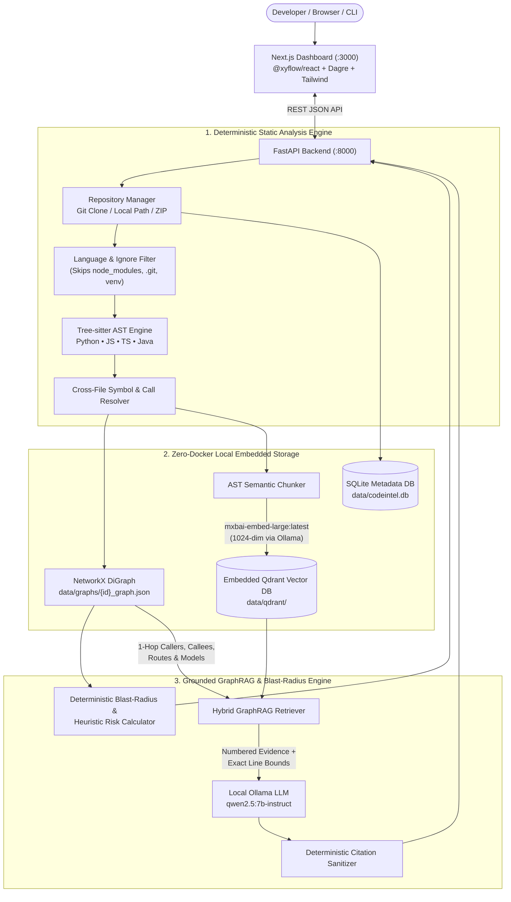

# CodeIntel — Local-First Codebase Intelligence Platform

**AST Knowledge Graph • Semantic Code Search • Grounded Hybrid GraphRAG • Deterministic Blast-Radius Impact Simulator**

`CodeIntel` is a 100% local, open-source developer intelligence platform that transforms any multi-language codebase into an interactive **Code Knowledge Graph** and **Semantic Vector Index**. It enables developers to visually explore system architecture, search code by natural-language intent, ask grounded architectural questions with verified `file:line` citations, and simulate the upstream **Change Impact ("Blast Radius")** of modifying any file, class, or function before writing code.

---

## Table of Contents

1. [Why CodeIntel? (Problem & Solution)](#1-why-codeintel-problem--solution)
2. [System Architecture & Processing Pipeline](#2-system-architecture--processing-pipeline)
3. [Core Modules & Capabilities](#3-core-modules--capabilities)
4. [Technology Stack](#4-technology-stack)
5. [How to Start the Project (Step-by-Step Guide)](#5-how-to-start-the-project-step-by-step-guide)
   - [Option A: One-Command Full-Stack Launch (Recommended)](#option-a-one-command-full-stack-launch-recommended)
   - [Option B: Manual Two-Terminal Launch (Backend + Frontend)](#option-b-manual-two-terminal-launch-backend--frontend)
   - [Option C: Standalone CLI Codebase Analyzer](#option-c-standalone-cli-codebase-analyzer)
6. [5-Tab Visual Dashboard Walkthrough](#6-5-tab-visual-dashboard-walkthrough)
7. [Deterministic Blast-Radius Risk Scoring Formula](#7-deterministic-blast-radius-risk-scoring-formula)
8. [REST API Contract](#8-rest-api-contract)
9. [Verified Benchmark Metrics](#9-verified-benchmark-metrics)
10. [Repository Directory Structure](#10-repository-directory-structure)
11. [Testing, Linting & Benchmarking Commands](#11-testing-linting--benchmarking-commands)
12. [Troubleshooting (Windows 11)](#12-troubleshooting-windows-11)

---

## 1. Why CodeIntel? (Problem & Solution)

When developers inherit or onboard onto a repository with dozens of routes, controllers, services, and database models, understanding cross-file execution flows takes days of manual reading:
- **Keyword search (`Ctrl+F` / `grep`) fails on intent queries:** Searching for *"admin authorization"* misses code written as `!user.getRole().equals("ADMIN")`.
- **Naive RAG chatbots hallucinate:** Treating source files as flat text chunks strips away structural call/import relationships, causing LLMs to guess dependencies or invent non-existent file names and line numbers.
- **Blind refactoring breaks production:** Modifying a shared service without knowing all transitive callers, exposed HTTP endpoints, and regression test suites introduces regressions.

**How CodeIntel solves this:**
1. **Deterministic AST Parsing First (`tree-sitter`):** Parses Python (`.py`), JavaScript (`.js`, `.jsx`), TypeScript (`.ts`, `.tsx`), and Java (`.java`) into exact syntax entities (`file`, `class`, `function`, `method`, `api_endpoint`, `model`) with exact start/end line numbers.
2. **Cross-File Code Knowledge Graph (`NetworkX`):** Resolves cross-file imports, function calls, route handlers, and model queries into a directed graph (`DECLARES`, `IMPORTS`, `CALLS`, `INHERITS`, `ROUTES_TO`, `QUERIES`) ranked by PageRank centrality.
3. **AST-Bounded Vector Search (`Qdrant` + `mxbai-embed-large:latest`):** Embeds complete functions/classes enriched with context headers (`File | Signature | Outgoing Calls`) into a local 1024-dimensional Qdrant index.
4. **Grounded Hybrid GraphRAG (`qwen2.5:7b-instruct`):** Combines semantic top-$k$ retrieval with 1-hop knowledge graph expansion and passes every citation through a deterministic **Citation Sanitizer** that guarantees 100% of cited files and line ranges exist in the repository.
5. **Deterministic Blast-Radius Engine:** Traverses reverse dependency edges to compute direct dependents, transitive dependents, affected API endpoints, related test suites, and an explainable `0–100` risk score (`Low`, `Medium`, `High`).

---

## 2. System Architecture & Processing Pipeline



---

## 3. Core Modules & Capabilities

| Module | Implementation File(s) | Key Responsibilities |
| :--- | :--- | :--- |
| **Module 1: Repository Analyzer** | `backend/app/services/repository/manager.py`<br>`language_detector.py` | Accepts local folders, `.zip` archives, or GitHub HTTPS URLs (`depth=1`); prunes noisy directories (`node_modules`, `.git`, `.venv`, `dist`); detects languages & frameworks (`Express.js`, `FastAPI`, `Spring Boot`, `Mongoose`, `Jest`, `Pytest`); computes SHA-256 hashes per file. |
| **Module 2: Tree-sitter AST Parser & Graph Builder** | `backend/app/services/parser/tree_sitter_engine.py`<br>`extractors.py`<br>`backend/app/services/graph/resolver.py`<br>`builder.py` | Extracts classes, functions, methods, parameters, docstrings, imports, calls, HTTP routes, and database models; resolves cross-file symbols; builds `NetworkX` `DiGraph` with PageRank centrality. |
| **Module 3: Semantic Code Search** | `backend/app/services/parser/chunker.py`<br>`backend/app/services/embeddings/vector_store.py` | Chunks code along AST function/class boundaries with context headers; embeds into 1024-dim vectors via `mxbai-embed-large:latest`; skips unchanged chunks via SHA-256 hash comparison. |
| **Module 4: Grounded Hybrid GraphRAG Assistant** | `backend/app/services/retrieval/hybrid_rag.py`<br>`ollama_client.py` | Merges top-$k$ Qdrant semantic hits with 1-hop `NetworkX` callers/callees; queries `qwen2.5:7b-instruct` with strict JSON schema; strips any hallucinated citation via `sanitize_citations()`. |
| **Module 5: Blast-Radius & Change Impact Analyzer** | `backend/app/services/impact/analyzer.py` | Traverses reverse functional edges (`IMPORTS`, `CALLS`, `ROUTES_TO`, `QUERIES`, `INHERITS`) to find direct & transitive dependents, affected API routes, covering test files, and deterministic `0–100` risk scores. |
| **Module 6: Visual Architecture Explorer** | `frontend/src/components/*`<br>`frontend/src/lib/layout-graph.ts` | Dark-mode Next.js dashboard with `@xyflow/react` v12 interactive graphs, automatic `dagre` `LR`/`TB` hierarchical layout, syntax-numbered source viewer, and 1-click citation navigation. |

---

## 4. Technology Stack

| Layer | Technology | Purpose |
| :--- | :--- | :--- |
| **Backend API** | Python 3.11+ • **FastAPI** • **Pydantic v2** | High-speed REST API with automatic OpenAPI documentation (`/docs`). |
| **AST Parsing** | **`tree-sitter` (v0.23+)** | Deterministic multi-language syntax parsing (`python`, `javascript`, `typescript`, `java`). |
| **Knowledge Graph** | **`NetworkX` (`nx.DiGraph`)** | In-memory directed graph traversal, shortest execution paths, PageRank centrality, and JSON persistence. |
| **Vector Database** | **`qdrant-client` (Embedded Local Mode)** | Zero-Docker on-disk vector store (`./data/qdrant`) with 1024-dim Cosine similarity and payload filtering. |
| **Metadata DB** | **SQLite + SQLAlchemy 2.0** | Persistent repository inventory and indexing statistics (`./data/codeintel.db`). |
| **Local Embedding Model** | **Ollama: `mxbai-embed-large:latest`** | 1024-dimension semantic code & query embeddings (with automatic deterministic semantic fallback when Ollama is offline). |
| **Local Reasoning LLM** | **Ollama: `qwen2.5:7b-instruct`** | Grounded architectural synthesis and execution flow tracing. |
| **Frontend UI** | **Next.js 14 • TypeScript • Tailwind CSS • Lucide** | Responsive dark-mode developer workspace (`bg-slate-950`). |
| **Graph Visualization** | **`@xyflow/react` (v12) + `dagre`** | Interactive node/edge canvas with automatic hierarchical layout, minimap, and side inspector. |

---

## 5. How to Start the Project (Step-by-Step Guide)

### Prerequisites
- **Python 3.11+** installed (`python --version`)
- **Node.js 18+** and **npm** installed (`node --version`)
- **Ollama** *(Optional but recommended for live GPU inference)* with pre-installed models:
  - `mxbai-embed-large:latest`
  - `qwen2.5:7b-instruct`
  *(Note: If Ollama is not running, CodeIntel automatically falls back to its built-in deterministic 1024-dim semantic embedder and grounded evidence synthesizer so the entire platform works out-of-the-box with zero external dependencies).*

---

### Step 1: First-Time Setup (Only Needed Once)

Open PowerShell in the repository root (`C:\Users\KESHAV\Documents\ROSP_Project`) and run:

```powershell
# 1. Create Python venv, install backend packages, and generate the sample_ecommerce repo
python scripts/tasks.py setup

# 2. Install frontend Node.js dependencies (if not already installed)
npm install --prefix frontend
```

*(Optional)* Check if your local Ollama server and models are active:
```powershell
python scripts/tasks.py check-ollama
```
If Ollama is not currently running and you want live LLM inference, start it in a separate terminal with `ollama serve`.

---

### Option A: One-Command Full-Stack Launch (Recommended)

To start **both** the FastAPI backend (`http://localhost:8000`) and the Next.js frontend (`http://localhost:3000`) together in a single command:

```powershell
python scripts/tasks.py demo
```

Once started:
- **Open the Visual Dashboard:** [http://localhost:3000](http://localhost:3000)
- **Open Backend Swagger API Docs:** [http://localhost:8000/docs](http://localhost:8000/docs)
- **Stop both servers:** Press `Ctrl + C` in the terminal.

> On first startup, the backend automatically seeds and indexes `./data/sample_ecommerce` (15 source files across JavaScript/Express and Python) so the dashboard is populated immediately when you open `http://localhost:3000`.

---

### Option B: Manual Two-Terminal Launch (Backend + Frontend)

If you prefer running the backend and frontend in two separate PowerShell terminals to see their logs independently:

**Terminal 1 — Start the FastAPI Backend (`:8000`):**
```powershell
python scripts/tasks.py serve
```
*(Or directly via virtual environment)*:
```powershell
cd backend
.\.venv\Scripts\python.exe -m uvicorn app.main:app --reload --port 8000
```

**Terminal 2 — Start the Next.js Frontend (`:3000`):**
```powershell
cd frontend
npm run dev
```

Then open [http://localhost:3000](http://localhost:3000) in your browser.

---

### Option C: Standalone CLI Codebase Analyzer

You can also run the deterministic AST + Knowledge Graph analyzer directly from the command line on any folder without starting the web servers:

```powershell
# Analyze the included sample_ecommerce repository
python scripts/tasks.py analyze-sample
```

Or analyze any custom local directory path:
```powershell
.\backend\.venv\Scripts\python.exe -m app.cli analyze "C:\path\to\your\repo" --output-dir ./data/cli_out
```

**Sample CLI Output:**
```text
============================================================
  CODEBASE INTELLIGENCE ANALYZER
============================================================
Repository        : sample_ecommerce (sample_ecommerce)
Languages         : {'python': 2, 'javascript': 13}
Frameworks        : Express.js, Jest, Mongoose, Python Microservice
------------------------------------------------------------
Files discovered  : 15
Files parsed      : 15
Functions/Methods : 25
Classes & Models  : 3 (2 models)
API Endpoints     : 5
Imports discovered: 24
Call relationships: 60
Knowledge Graph   : 47 nodes, 87 edges
Analysis Latency  : 132.45 ms
------------------------------------------------------------
Written artifacts : data/cli_out/graph.json, data/cli_out/analysis_report.json, data/cli_out/dependencies.json
============================================================
```

---

## 6. 5-Tab Visual Dashboard Walkthrough

When you open [http://localhost:3000](http://localhost:3000), the workspace provides 5 integrated tabs:

1. **Overview Tab:**
   - Displays KPI metric cards (`Parsed Source Files`, `Functions & Methods`, `Classes & Models`, `API Endpoints`, `Knowledge Graph Nodes/Edges`).
   - Shows the **Deterministic Architectural Summary**, detected frameworks (`Express.js`, `Mongoose`, `Jest`, `Python Microservice`), language distribution bar, and the **Top Central Components** table ranked by `NetworkX` PageRank with 1-click buttons for `Code`, `Graph`, and `Impact`.
2. **Code Explorer Tab:**
   - **Left Pane:** Filterable repository file tree with line counts.
   - **Middle Pane:** All extracted AST symbols (`api_endpoint`, `class`, `model`, `function`, `method`) with line ranges, signatures, docstrings, and outgoing call expressions.
   - **Right Pane:** Syntax-numbered source code viewer with automatic line-range highlighting when jumping from a symbol or AI citation.
3. **Knowledge Graph Tab (`@xyflow/react` + `dagre`):**
   - Renders color-coded interactive AST nodes (`file` = blue, `api_endpoint` = emerald, `function`/`method` = purple, `class` = amber, `model` = rose).
   - Filter by entity type, search by label, switch between `Left → Right (LR)` and `Top → Bottom (TB)` Dagre hierarchical layouts, or click **Focus 2-Hop Neighborhood** on any selected node.
   - **Side Inspector Panel:** Displays the selected node's signature, PageRank, incoming dependents, outgoing callees, and a 1-click **"Run Impact Analysis on This Node"** button.
4. **AI Assistant Tab (Hybrid GraphRAG + Semantic Search):**
   - **Left Panel (Grounded GraphRAG Chat):** Click any prompt chip (e.g., *"How does user authentication work in this project?"*) or ask a custom question. Displays the grounded markdown explanation, a numbered **Traced Execution Flow** (`POST /login` $\rightarrow$ `loginUser` $\rightarrow$ `authenticate` $\rightarrow$ `User`), and clickable **Verified AST Source Citations** (`file_path:Lstart-Lend`) that open the exact lines in the Code Explorer.
   - **Right Panel (Semantic Code Search):** Search by natural-language intent (e.g., *"verify whether a user is allowed to access protected routes"*) to retrieve matching functions via 1024-dim Qdrant vector similarity.
5. **Impact Analysis Tab (Blast-Radius Simulator):**
   - Select any file or symbol (e.g., `backend/services/paymentService.js`) and click **Recompute Blast Radius**.
   - Displays the **Risk Level Badge** (`Low` / `Medium` / `High`), **Heuristic Risk Score Gauge (`0–100`)**, transparent risk factor bullets, lists of 1-hop and $k$-hop impacted components, **Affected Public API Endpoints** (`POST /checkout`, `POST /refund`, `POST /orders`), **Regression Test Suites** (`backend/tests/payment.test.js`), and an interactive **Visual Blast-Radius Subgraph**.

---

## 7. Deterministic Blast-Radius Risk Scoring Formula

Unlike LLM-guessed risk ratings, `CodeIntel` computes `risk_score` $\in [0, 100]$ deterministically in `backend/app/services/impact/analyzer.py`:

$$S = S_{\text{direct}} + S_{\text{trans}} + S_{\text{api}} + S_{\text{test}}$$

1. **Direct Dependents Score ($S_{\text{direct}}$, max $35$ pts):** $\min(35,\; \text{count}(\text{1-hop callers/importers}) \times 7.0)$
2. **Transitive Blast Radius Score ($S_{\text{trans}}$, max $25$ pts):** $\min(25,\; \text{count}(\text{all upstream ancestors}) \times 2.5)$
3. **Public API Exposure Score ($S_{\text{api}}$, max $20$ pts):** $\min(20,\; \text{count}(\text{affected API endpoints}) \times 10.0)$
4. **Missing Test Coverage Penalty ($S_{\text{test}}$, max $20$ pts):** $0$ pts if at least 1 test file (`*test*` or `*spec*`) covers the upstream blast radius; $+20$ pts penalty if **zero** test files exist in the upstream path.

- **Risk Level Thresholds:**
  - `Low`: $S < 30$
  - `Medium`: $30 \le S < 60$
  - `High`: $S \ge 60$

---

## 8. REST API Contract

All endpoints are prefixed with `/api` (Base URL: `http://localhost:8000/api`):

| Method | Endpoint | Description |
| :--- | :--- | :--- |
| `GET` | `/api/health` | Returns backend health, Ollama reachability, and active embedding/LLM model names. |
| `POST` | `/api/repositories` | Ingests a local path, `.zip`, or GitHub URL (`{"source": "...", "name": "..."}`), runs AST + Graph + Vector indexing. |
| `GET` | `/api/repositories` | Lists all indexed repositories stored in SQLite. |
| `GET` | `/api/repositories/{repo_id}` | Returns overview stats, language breakdown, frameworks, PageRank central modules, and file inventory. |
| `GET` | `/api/repositories/{repo_id}/files/content` | Returns source code, AST symbols, imports, and calls for `?path=<relative_posix_path>`. |
| `GET` | `/api/repositories/{repo_id}/graph` | Returns `@xyflow/react` nodes & edges (`?node_type=`, `?search=`, `?focus_node_id=`, `?hops=2`). |
| `GET` | `/api/repositories/{repo_id}/search` | Hybrid 1024-dim vector + symbol search (`?q=<query>&limit=8`). |
| `POST` | `/api/repositories/{repo_id}/ask` | Hybrid GraphRAG Q&A (`{"question": "...", "top_k": 6}`) with verified citations and execution steps. |
| `POST` | `/api/repositories/{repo_id}/impact-analysis` | Computes Blast-Radius `ImpactReport` (`{"target_id": "backend/services/paymentService.js"}`). |

---

## 9. Verified Benchmark Metrics

Generated by `python scripts/tasks.py benchmark` and saved in `results/benchmarks.json`:

| Metric | Measured Result | Target |
| :--- | :--- | :--- |
| **AST Parsing Latency (15 files, 29 chunks)** | **14.73 ms** (`1,018.3 files/sec`) | $< 5,000$ ms |
| **Knowledge Graph Build (`47 nodes`, `87 edges`)** | **4.46 ms** | $< 500$ ms |
| **Blast-Radius Impact Query Latency** | **0.18 ms** (`100.0%` dependency recall) | $< 100$ ms |
| **Semantic Search Top-3 Recall (`Hit@3`)** | **100.0%** (`5 / 5` intent queries) | $\ge 80\%$ |
| **GraphRAG Citation Verification Rate** | **100.0%** (`18 / 18` citations verified) | $100\%$ |

---

## 10. Repository Directory Structure

```text
ROSP_Project/
├── AGENTS.md                              # Canonical operating rules for AI coding agents
├── HANDOFF.md                             # Session handoff state
├── PROGRESS.md                            # Master 33-task checklist (Phases 0–6)
├── README.md                              # Project documentation & quickstart guide
├── docker-compose.yml                     # Optional containerized deployment profile
├── .env.example                           # Environment variable template
├── docs/
│   ├── MASTER_PLAN.md                     # Full architectural blueprint
│   ├── plan/                              # Per-phase split specifications
│   ├── architecture.md                    # System architecture & Mermaid diagrams
│   ├── api.md                             # REST API endpoint reference
│   └── decision_log.md                    # Architectural Decision Records (ADRs)
├── scripts/
│   ├── status.py                          # Session status & git summary printer
│   ├── tasks.py                           # Unified task runner (setup, test, lint, serve, demo, benchmark)
│   ├── split_plan.py                      # Splits MASTER_PLAN.md into docs/plan/
│   ├── create_sample_repo.py              # Generates data/sample_ecommerce testbed
│   └── benchmark.py                       # Runs evaluation suite & writes results/benchmarks.json
├── results/
│   └── benchmarks.json                    # Recorded latency, recall, and citation accuracy metrics
├── backend/
│   ├── pyproject.toml                     # Python dependencies & Ruff/Pytest config
│   ├── app/
│   │   ├── main.py                        # FastAPI entrypoint, CORS & startup auto-seeding
│   │   ├── cli.py                         # Standalone CLI analyzer (`python -m app.cli analyze`)
│   │   ├── config.py                      # Pydantic Settings configuration
│   │   ├── db.py                          # SQLAlchemy 2.0 SQLite persistence
│   │   ├── api/routes.py                  # All 9 REST API endpoints
│   │   ├── schemas/                       # Pydantic v2 request/response models
│   │   └── services/
│   │       ├── repository/                # Git/Local/ZIP ingestion & language/framework detector
│   │       ├── parser/                    # Tree-sitter AST engine, extractors & semantic chunker
│   │       ├── graph/                     # Cross-file symbol resolver, NetworkX builder & queries
│   │       ├── embeddings/                # Ollama client & embedded local Qdrant vector store
│   │       ├── retrieval/                 # Hybrid GraphRAG & deterministic citation sanitizer
│   │       └── impact/                    # Blast-Radius analyzer & heuristic risk scorer
│   └── tests/                             # 17 unit & integration tests (ingestion, AST, graph, RAG, API)
└── frontend/
    ├── package.json                       # Next.js 14, @xyflow/react v12, dagre, Tailwind CSS
    └── src/
        ├── app/                           # App Router layout, dark theme & 5-tab workspace page
        ├── lib/                           # Typed API client & Dagre hierarchical graph layout
        ├── types/                         # TypeScript interfaces matching backend schemas
        └── components/                    # Navbar, OverviewTab, CodeExplorerTab, KnowledgeGraphTab, AssistantTab, ImpactAnalysisTab
```

---

## 11. Testing, Linting & Benchmarking Commands

All project automation is available via `python scripts/tasks.py <command>`:

```powershell
# Display project task status, git branch, and recent commits
python scripts/tasks.py status

# Run fast pytest suite (stops on first failure)
python scripts/tasks.py test-fast

# Run full verbose pytest suite (17/17 tests)
python scripts/tasks.py test

# Run Ruff linter on backend Python code
python scripts/tasks.py lint

# Run Frontend TypeScript compiler verification
npm run typecheck --prefix frontend

# Run standalone CLI analyzer on sample_ecommerce
python scripts/tasks.py analyze-sample

# Run automated benchmark suite and update results/benchmarks.json
python scripts/tasks.py benchmark
```

---

## 12. Troubleshooting (Windows 11)

1. **`Port 8000 or 3000 is already in use`:**
   - Ensure no previous `uvicorn` or `next dev` process is still running, or stop existing processes in Task Manager / PowerShell before running `python scripts/tasks.py demo`.
2. **Ollama is not running (`Connection refused` on port `11434`):**
   - `CodeIntel` will continue working seamlessly using its built-in deterministic fallback mode. To enable live GPU inference with `qwen2.5:7b-instruct` and `mxbai-embed-large:latest`, run `ollama serve` in a separate terminal.
3. **PowerShell execution policy blocks `.venv\Scripts\Activate.ps1`:**
   - You do not need to manually activate the virtual environment—`python scripts/tasks.py <command>` automatically invokes `.\backend\.venv\Scripts\python.exe` directly.
