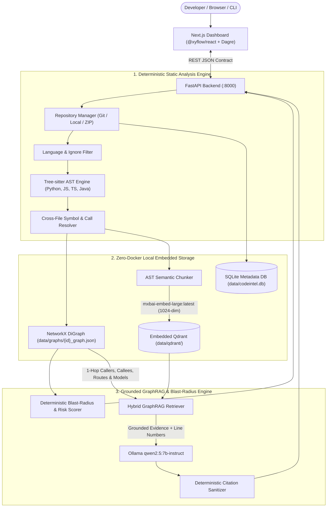

# CodeIntel System Architecture

## 1. End-to-End Processing Pipeline

## 2. Core Architectural Principles

1. **Deterministic Static Analysis First:**
   - Every node (`file`, `class`, `function`, `method`, `api_endpoint`, `model`) and directed edge (`DECLARES`, `IMPORTS`, `CALLS`, `INHERITS`, `ROUTES_TO`, `QUERIES`) is extracted deterministically via `tree-sitter` and resolved via `CrossFileResolver`.
   - Graph centrality is computed using `NetworkX` PageRank on the reversed functional dependency subgraph so foundational models and core services surface automatically.

2. **Explainable Heuristic Risk Formula:**
   - Given any target node $v$, `ImpactAnalyzer` traverses reverse functional edges to identify 1-hop direct dependents, $k$-hop transitive dependents, exposed API endpoints, and regression test files:
     $$S = S_{\text{direct}} (\le 35) + S_{\text{trans}} (\le 25) + S_{\text{api}} (\le 20) + S_{\text{test\_penalty}} (\le 20)$$
   - Risk levels: `Low` ($S < 30$), `Medium` ($30 \le S < 60$), `High` ($S \ge 60$).

3. **Zero-Hallucination Citation Sanitizer:**
   - Every citation emitted by the Hybrid GraphRAG assistant is cross-checked against the repository's indexed file inventory and line bounds before returning to the client.

